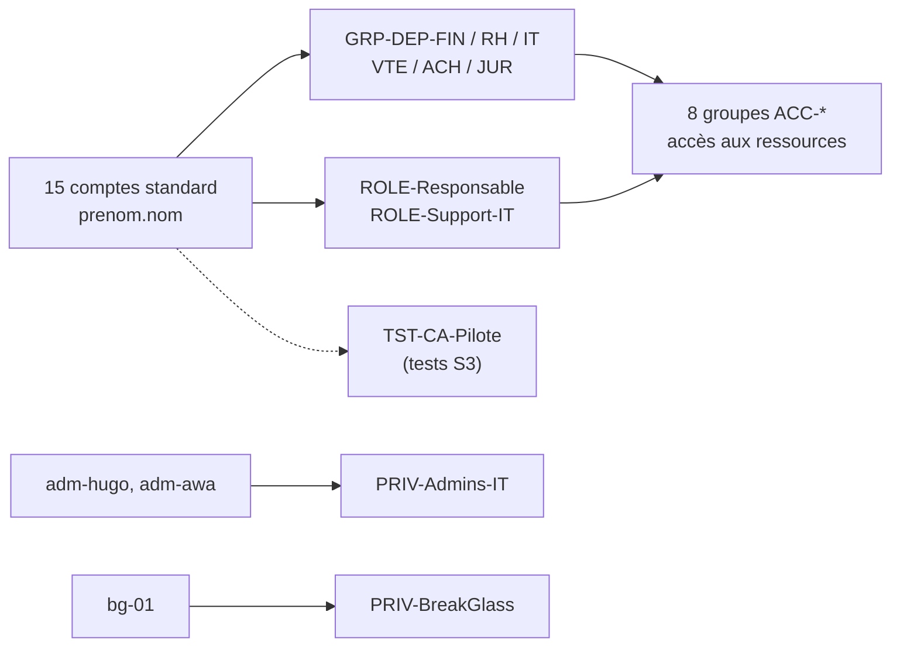

# Schéma d'architecture v1 — modèle de groupes du lab Entra ID

Les utilisateurs n'ont jamais de droits directs : ils appartiennent à des groupes de département (`GRP-DEP-`) ou de rôle (`ROLE-`), qui sont eux-mêmes membres de groupes d'accès (`ACC-`). Les comptes à privilèges sont isolés dans `PRIV-`.

## Groupes

| Préfixe | Rôle | Groupes |
|---|---|---|
| `GRP-DEP-` | Département (devient dynamique au S2) | FIN, RH, IT, VTE, ACH, JUR |
| `ROLE-` | Fonction | Responsable, Support-IT |
| `ACC-` | Accès à une ressource (contiennent des groupes) | ERP-Finance, SIRH-RH, Outils-IT, CRM-Ventes, Achats-Fournisseurs, Contrats-Juridique, Reporting-Direction, Helpdesk-IT |
| `PRIV-` | Comptes à privilèges | Admins-IT, BreakGlass |
| `TST-` | Tests | CA-Pilote |
